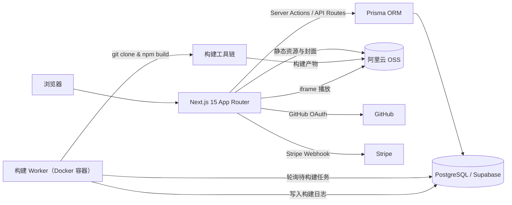

# VibeDrop

> 面向 Vibe Coding 社区的 App 分享与试玩平台。

[](https://nextjs.org/)
[](https://react.dev/)
[](https://www.typescriptlang.org/)
[](https://www.prisma.io/)
[](./LICENSE)

VibeDrop 让用 Cursor、v0、Bolt、Lovable 等 AI 工具做出来的 Web App 有一个「可玩」的展示空间：
作者上传 ZIP 或连接 GitHub 仓库，平台自动构建并托管；访客可以在手机外壳中直接试玩、点赞、评论、Fork 和打赏。

## 目录

- [功能特性](#功能特性)
- [界面预览](#界面预览)
- [技术架构](#技术架构)
- [技术栈](#技术栈)
- [快速开始](#快速开始)
- [环境变量](#环境变量)
- [常用脚本](#常用脚本)
- [目录结构](#目录结构)
- [测试](#测试)
- [部署](#部署)
- [项目文档](#项目文档)
- [参与贡献](#参与贡献)
- [许可证](#许可证)

## 功能特性

### 发布与构建

| 能力 | 说明 |
|------|------|
| ZIP 上传 | 直接上传构建好的静态资源，自动解压并托管 |
| GitHub 自动构建 | 关联公开仓库，Worker 自动克隆、安装依赖并构建 |
| 多框架支持 | 自动识别并构建 React / Vue / Vite / Expo / Flutter Web 项目 |
| 构建历史与回滚 | 保留每次构建记录、日志与产物，可一键回滚到历史版本 |
| 浏览器内编辑器 | 基于 Monaco 的在线代码编辑器，可直接修改并重新部署 |
| 多人协作 | App 作者可邀请协作者共同维护 |

### 社区与试玩

| 能力 | 说明 |
|------|------|
| 社区大厅 | 搜索、标签筛选、混合排序（时间 + 热度） |
| 手机外壳播放器 | iPhone / Android 外壳、横竖屏切换、全屏模式 |
| 原生云模拟器 | 基于 redroid 的 Android 云模拟器（可选，需要 KVM） |
| 互动 | 点赞、评论、举报、Fork、打赏（Stripe） |
| 用户主页 | 展示作者信息与其发布的所有 App |
| 分享卡片 | 三种模板的动态 OG Image，便于社交平台传播 |

### 认证与安全

| 能力 | 说明 |
|------|------|
| 登录方式 | GitHub / Google OAuth；NextAuth Credentials（邮箱 / 密码） |
| 账号能力 | 注册、邮箱验证、密码重置（Server Actions）；权限控制：作者 / 协作者 / 管理员 |
| XSS 防护 | `sanitize-html` 在 Zod 校验层统一清洗 |
| CSRF 防护 | Origin / Referer 校验 |
| 限流 | 全局 20 req/min，认证接口 5 req/min |
| 加密 | GitHub Token 使用 AES-256-GCM 加密存储 |
| 安全响应头 | CSP、HSTS 等 6 项响应头 |

## 界面预览

> 截图来自本地开发实例（暗色主题为默认主题）。

| 首页（桌面） | 登录页 | 首页（移动端） |
|--------------|--------|----------------|
|  |  |  |

## 技术架构



- **Web 层**：Next.js 15 App Router + React Server Components，页面数据在服务端读取。
- **数据层**：Prisma + PostgreSQL；Like / Comment 等计数在事务中原子更新。
- **构建层**：独立 Worker 进程（运行于 Docker 容器）轮询数据库，在容器内执行 `git clone` 与项目构建，产物上传 OSS。
- **存储层**：OSS 存放 ZIP、构建产物与封面图；数据库只保存元数据与 URL。

## 技术栈

| 层次 | 技术 |
|------|------|
| 前端 | Next.js 15（App Router / RSC）、React 19、TypeScript 5.7 |
| 样式与组件 | Tailwind CSS v4、shadcn/ui、lucide-react |
| 数据 | PostgreSQL、Prisma 6 |
| 认证 | NextAuth.js v5（GitHub / Google OAuth + Credentials） |
| 存储 | 阿里云 OSS |
| 构建 | Node.js 构建 Worker、Docker、git / npm 工具链 |
| 在线编辑 | Monaco Editor |
| 支付 | Stripe |
| 测试 | Vitest（集成）、Playwright（E2E） |
| CI / 部署 | GitHub Actions、Docker Compose、nginx、Let's Encrypt |

## 快速开始

### 前置要求

- Node.js 20+
- PostgreSQL 14+（或 Supabase）
- 可选：Docker（本地一键启动 / 构建 Worker）

### 1. 安装依赖

```bash
npm install
```

### 2. 配置环境变量

```bash
cp .env.example .env.local
# 编辑 .env.local，至少填入 DATABASE_URL、NEXTAUTH_SECRET、GitHub OAuth、OSS 配置
```

所有变量说明见下方[环境变量](#环境变量)。

### 3. 初始化数据库

```bash
npx prisma generate
npx prisma migrate dev --name init
```

### 4. 启动开发服务器

```bash
npm run dev
# http://localhost:3000
```

### 使用 Docker 启动完整本地栈

```bash
cp .env.example .env.local   # 填入云端数据库与 OSS 配置
docker compose up --build    # app (3000) + build worker
```

> 本地 compose 不包含 PostgreSQL，`DATABASE_URL` 指向外部数据库（Supabase 或自建实例）。

## 环境变量

| 变量 | 必填 | 说明 |
|------|:----:|------|
| `DATABASE_URL` | ✅ | PostgreSQL 连接串 |
| `NEXTAUTH_URL` | ✅ | 站点地址，如 `http://localhost:3000` |
| `NEXTAUTH_SECRET` | ✅ | NextAuth 会话签名密钥（`openssl rand -hex 16`） |
| `GITHUB_CLIENT_ID` | ✅ | GitHub OAuth App Client ID |
| `GITHUB_CLIENT_SECRET` | ✅ | GitHub OAuth App Client Secret |
| `GOOGLE_CLIENT_ID` / `GOOGLE_CLIENT_SECRET` | — | Google OAuth（启用 Google 登录时填写） |
| `OSS_REGION` | ✅ | 阿里云 OSS 地域 |
| `OSS_BUCKET` | ✅ | OSS Bucket 名称 |
| `OSS_ACCESS_KEY_ID` | ✅ | OSS AccessKey ID |
| `OSS_ACCESS_KEY_SECRET` | ✅ | OSS AccessKey Secret |
| `ENCRYPTION_KEY` | ✅ | GitHub Token 加密密钥，≥ 32 字符（`openssl rand -hex 32`） |
| `ADMIN_GITHUB_IDS` | — | 管理员 GitHub 用户 ID，逗号分隔 |
| `SMTP_HOST` / `SMTP_PORT` / `SMTP_USER` / `SMTP_PASS` / `EMAIL_FROM` | — | 邮件服务，生产环境启用邮箱认证时必填 |
| `STRIPE_SECRET_KEY` / `STRIPE_WEBHOOK_SECRET` | — | 打赏功能所需 |
| `EMULATOR_ENABLED` / `EMULATOR_DOCKER_HOST` / `EMULATOR_MAX_SESSIONS` / `EMULATOR_SESSION_TIMEOUT` | — | 原生云模拟器配置 |

完整的变量模板见 [`.env.example`](./.env.example) 与 [`.env.production.example`](./.env.production.example)。

> ⚠️ 不要提交真实的 `.env*` 文件。`NEXTAUTH_SECRET`、`ENCRYPTION_KEY` 等请使用 `openssl rand` 在目标环境生成。

## 常用脚本

| 命令 | 说明 |
|------|------|
| `npm run dev` | 启动开发服务器 |
| `npm run build` | 生产构建 |
| `npm run start` | 启动生产服务器 |
| `npm run lint` | ESLint 检查 |
| `npm run typecheck` | TypeScript 类型检查 |
| `npm run db:generate` | `prisma migrate dev`，创建并应用迁移 |
| `npm run db:migrate` | `prisma migrate deploy`，应用已有迁移 |
| `npm run db:studio` | 打开 Prisma Studio |
| `npm run build-worker` | 启动构建 Worker |
| `npm test` | 运行 Vitest 集成测试 |
| `npm run test:watch` | 监听模式运行测试 |
| `npm run test:e2e` | 运行 Playwright E2E 测试 |

## 目录结构

```text
VibeDrop/
├── src/
│   ├── app/                     # Next.js App Router：页面 + API Routes
│   │   ├── page.tsx             # 首页 / Landing
│   │   ├── apps/                # 社区大厅、App 详情、手机外壳、编辑器、构建
│   │   ├── publish/             # 发布流程（ZIP 上传 / GitHub 仓库）
│   │   ├── auth/                # 登录、注册、邮箱验证、重置密码
│   │   ├── users/               # 用户主页
│   │   ├── admin/reports/       # 举报管理后台
│   │   └── api/                 # 认证、App、构建、模拟器、OG Image、Webhook
│   ├── components/              # 通用组件（Header、Footer、AppCard、UI 基础组件）
│   ├── lib/                     # 业务逻辑与基础设施封装
│   └── middleware.ts            # 全局限流、认证接口限流与路由保护
├── prisma/
│   └── schema.prisma            # 数据模型（User/App/Build/Like/Comment/Report/...）
├── scripts/
│   └── build-worker.ts          # 构建 Worker 入口：轮询任务、执行构建、上传产物
├── tests/
│   ├── integration/             # Vitest 集成测试
│   ├── e2e/                     # Playwright E2E 测试
│   └── helpers/                 # 测试辅助工具
├── cli/                         # SkillHub CLI / Agent 插件（辅助工具，非平台运行时）
├── nginx/                       # 生产环境反向代理与证书初始化脚本
├── docs/                        # PRD、ADR、部署指南、Agent 文档、截图
├── .claude/                     # Spec / Plan / Exec 工作流记录
├── .scratch/                    # 本地 Issue 跟踪
├── docker-compose.yml           # 本地开发：app + worker
├── docker-compose.prod.yml      # 生产：app + worker + nginx + certbot
├── docker-compose.emulator.yml  # 可选：redroid 云模拟器
├── Dockerfile                   # app-runner / worker-runner 多阶段构建
└── .env.example                 # 环境变量模板（无真实密钥）
```

### 关键文件说明

| 文件 | 作用 |
|------|------|
| `src/lib/auth.ts` | NextAuth 配置、OAuth / 凭证登录、会话与 Cookie 安全设置 |
| `src/lib/build-executor.ts` | 构建执行器：识别框架、执行构建命令、收集产物 |
| `src/lib/encryption.ts` | AES-256-GCM 加解密（GitHub Token） |
| `src/lib/env.ts` | 启动时环境变量校验，缺失即报错 |
| `src/lib/permissions.ts` | 作者 / 协作者 / 管理员权限判断 |
| `src/lib/sanitize.ts` | 富文本 XSS 清洗（Zod transform 层） |
| `src/lib/csrf.ts` | Origin / Referer 校验 |
| `src/lib/validations.ts` | 全链路 Zod Schema |
| `src/lib/oss.ts` | 阿里云 OSS 上传与签名 |
| `src/lib/emulator/` | redroid 容器生命周期管理与会话池 |
| `src/lib/stripe.ts` | Stripe 客户端与打赏逻辑 |
| `src/middleware.ts` | 限流（全局 + 认证接口） |
| `prisma/schema.prisma` | 全部数据模型、枚举与索引 |
| `scripts/build-worker.ts` | 独立构建 Worker 进程 |
| `next.config.ts` | CSP / HSTS 等安全响应头 |
| `.github/workflows/ci.yml` | CI：Lint / 类型检查、Vitest、生产构建 |

## 测试

```bash
npm test          # Vitest：Prisma、Server Actions、点赞竞态、XSS 清洗
npm run test:e2e  # Playwright：页面导航与核心流程冒烟
npm run typecheck
```

> 注意：当前 `devDependencies` 尚未声明 `vitest` 与 `@playwright/test`。首次运行前请安装：
> `npm i -D vitest @playwright/test && npx playwright install`

CI 在 GitHub Actions 中运行 Lint / 类型检查、Vitest 集成测试（带 PostgreSQL service）与生产构建
（见 `.github/workflows/ci.yml`）。Playwright E2E 需在本地或独立环境中运行。

## 部署

生产部署（阿里云 ECS + Docker Compose + nginx + Let's Encrypt）的完整步骤见
[`docs/deployment.md`](./docs/deployment.md)，包括：

- 环境变量生成与安全清单
- `docker compose -f docker-compose.prod.yml up -d --build`
- SSL 证书申请与续期
- 备份、运维与已知限制

## 项目文档

| 文档 | 说明 |
|------|------|
| [`STATUS.md`](./STATUS.md) | 项目状态：已完成功能与路线图 |
| [`CONTEXT.md`](./CONTEXT.md) | 领域模型与术语表 |
| [`docs/prd-mvp.md`](./docs/prd-mvp.md) | 产品需求文档（27 个 User Story） |
| [`docs/deployment.md`](./docs/deployment.md) | 部署与运维指南 |
| [`docs/adr/`](./docs/adr/) | 架构决策记录 |
| [`.claude/AGENTS.md`](./.claude/AGENTS.md) | Spec → Plan → Exec 开发工作流 |
| [`.scratch/`](./.scratch/) | 本地 Issue 跟踪 |

## 参与贡献

1. Fork 本仓库并创建功能分支：`git checkout -b feat/your-feature`
2. 遵循 Spec → Plan → Exec 工作流（见 `.claude/AGENTS.md`）
3. 提交前运行 `npm run lint`、`npm run typecheck`、`npm test`
4. Commit message 使用英文，遵循 Conventional Commits（`feat:` / `fix:` / `docs:` …）
5. 提交 Pull Request，并描述改动动机与验证方式

## 许可证

本项目采用 [MIT License](./LICENSE) 开源。

Copyright (c) 2026 mrw7
