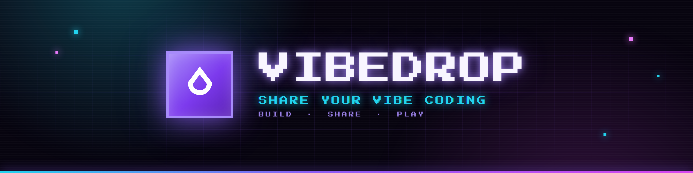
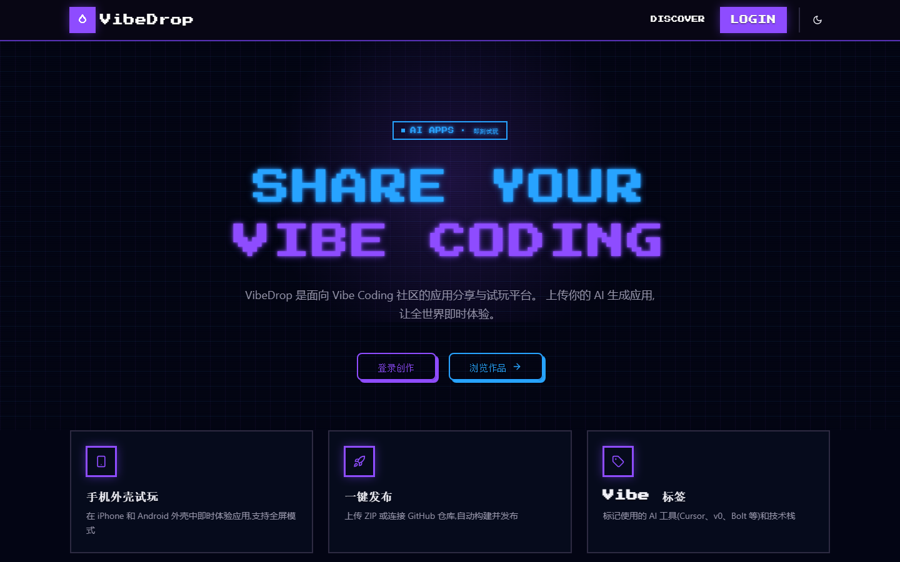
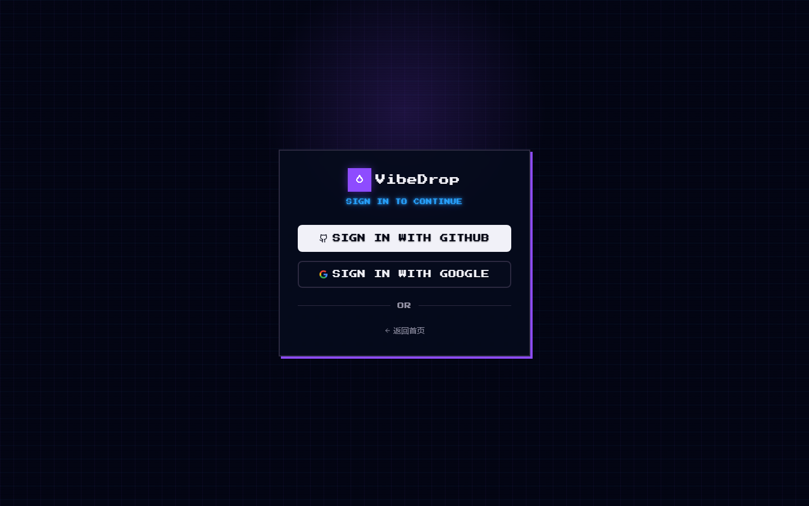
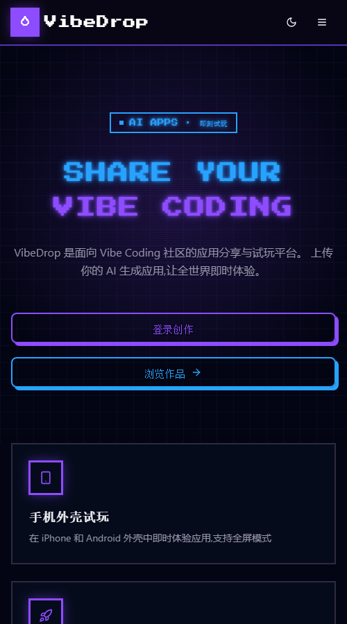
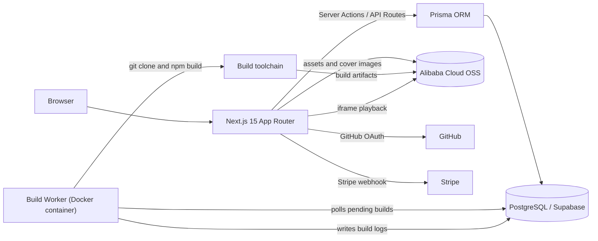

<div align="center">
  
</div>

<h1 align="center">VibeDrop</h1>

<p align="center">
  <b>Share, build and play AI-generated web apps.</b><br />
  An app sharing and play-testing platform for the Vibe Coding community.
</p>

<p align="center">
  <a href="https://nextjs.org/"></a>
  <a href="https://react.dev/"></a>
  <a href="https://www.typescriptlang.org/"></a>
  <a href="https://www.prisma.io/"></a>
  <a href="./LICENSE"></a>
  <a href="#contributing"></a>
</p>

<p align="center">
  <a href="#highlights">Highlights</a> ·
  <a href="#screenshots">Screenshots</a> ·
  <a href="#architecture">Architecture</a> ·
  <a href="#quick-start">Quick Start</a> ·
  <a href="#documentation">Docs</a> ·
  <a href="README.zh-CN.md">简体中文</a>
</p>

## Highlights

| 🚀 Publish in minutes | 📱 Play without installing | 🌍 Built for the community |
|:---:|:---:|:---:|
| Upload a ZIP or connect a GitHub repo. VibeDrop builds and hosts it automatically. | iPhone and Android frames, landscape mode and fullscreen playback — right in the browser. | Likes, comments, forks, tips and share cards turn every app into a social object. |

## Screenshots

<p align="center">
  
</p>

| Sign in | Home (mobile) |
|:---:|:---:|
|  |  |

> Captured from a local development instance. Dark is the default theme.

## Features

### Publishing & builds

- **ZIP upload** — upload prebuilt static assets; they are extracted and hosted automatically.
- **GitHub auto-build** — link a public repository and the worker clones, installs dependencies and builds it.
- **Multi-framework** — detects and builds React / Vue / Vite / Expo / Flutter Web projects.
- **Build history & rollback** — every build record, log and artifact is kept; roll back in one click.
- **In-browser editor** — a Monaco-based editor for changing code and redeploying without leaving the browser.
- **Collaboration** — app authors can invite collaborators to maintain an app together.

### Play & community

- **Community hall** — search, tag filters and a mixed ranking based on recency and popularity.
- **Phone shell player** — iPhone / Android shells, orientation switch and fullscreen mode.
- **Native cloud emulator** — an optional redroid-based Android emulator for native builds (requires KVM).
- **Interactions** — likes, comments, reports, forks and tips through Stripe.
- **User profiles** — author details and every app they have published.
- **Share cards** — dynamic OG images in three templates for social platforms.

### Authentication & security

- **Sign-in** — GitHub / Google OAuth plus NextAuth Credentials for email and password.
- **Accounts & roles** — sign-up, email verification, password reset, and author / collaborator / admin roles.
- **XSS & CSRF** — `sanitize-html` in the Zod validation layer and Origin / Referer validation.
- **Rate limiting** — 20 req/min globally and 5 req/min on authentication endpoints.
- **Encryption** — GitHub tokens are encrypted with AES-256-GCM.
- **Security headers** — CSP, HSTS and four more security headers.

## Architecture



- **Web layer** — Next.js 15 App Router with React Server Components; page data is read on the server.
- **Data layer** — Prisma + PostgreSQL. Counters such as likes and comments are updated atomically in transactions.
- **Build layer** — a standalone worker in a Docker container polls the database, builds projects inside the container and uploads artifacts to OSS.
- **Storage layer** — OSS stores ZIPs, build artifacts and cover images; the database keeps metadata and URLs only.

## Tech Stack

| Layer | Technology |
|-------|------------|
| Frontend | Next.js 15 (App Router / RSC), React 19, TypeScript 5.7 |
| Styling & UI | Tailwind CSS v4, shadcn/ui, lucide-react |
| Data | PostgreSQL, Prisma 6 |
| Auth | NextAuth.js v5 (GitHub / Google OAuth + Credentials) |
| Storage | Alibaba Cloud OSS |
| Build | Node.js build worker, Docker, git / npm toolchain |
| In-browser editing | Monaco Editor |
| Payments | Stripe |
| Testing | Vitest (integration), Playwright (E2E) |
| CI / Deployment | GitHub Actions, Docker Compose, nginx, Let's Encrypt |

## Quick Start

**Prerequisites:** Node.js 20+, PostgreSQL 14+ (or Supabase), and optionally Docker.

```bash
git clone https://github.com/mrw7/VibeDrop.git
cd VibeDrop
npm install
cp .env.example .env.local      # fill in DATABASE_URL, NEXTAUTH_SECRET, OAuth and OSS
npx prisma generate
npx prisma migrate dev --name init
npm run dev                     # http://localhost:3000
```

<details>
<summary><b>🐳 Run the full local stack with Docker</b></summary>

<br />

```bash
cp .env.example .env.local   # fill in the external database and OSS settings
docker compose up --build    # app (3000) + build worker
```

The local compose file does not include PostgreSQL. `DATABASE_URL` points to an
external database (Supabase or a self-hosted instance).

</details>

<details>
<summary><b>🔧 Environment variables</b></summary>

<br />

| Variable | Required | Description |
|----------|:--------:|-------------|
| `DATABASE_URL` | ✅ | PostgreSQL connection string |
| `NEXTAUTH_URL` | ✅ | Site URL, e.g. `http://localhost:3000` |
| `NEXTAUTH_SECRET` | ✅ | NextAuth session signing secret (`openssl rand -hex 16`) |
| `GITHUB_CLIENT_ID` | ✅ | GitHub OAuth App Client ID |
| `GITHUB_CLIENT_SECRET` | ✅ | GitHub OAuth App Client Secret |
| `GOOGLE_CLIENT_ID` / `GOOGLE_CLIENT_SECRET` | — | Google OAuth (required to enable Google sign-in) |
| `OSS_REGION` | ✅ | Alibaba Cloud OSS region |
| `OSS_BUCKET` | ✅ | OSS bucket name |
| `OSS_ACCESS_KEY_ID` | ✅ | OSS AccessKey ID |
| `OSS_ACCESS_KEY_SECRET` | ✅ | OSS AccessKey Secret |
| `ENCRYPTION_KEY` | ✅ | GitHub token encryption key, ≥ 32 characters (`openssl rand -hex 32`) |
| `ADMIN_GITHUB_IDS` | — | Comma-separated GitHub user IDs with admin access |
| `SMTP_HOST` / `SMTP_PORT` / `SMTP_USER` / `SMTP_PASS` / `EMAIL_FROM` | — | Mail service; required for email auth in production |
| `STRIPE_SECRET_KEY` / `STRIPE_WEBHOOK_SECRET` | — | Required for tips |
| `EMULATOR_ENABLED` / `EMULATOR_DOCKER_HOST` / `EMULATOR_MAX_SESSIONS` / `EMULATOR_SESSION_TIMEOUT` | — | Native cloud emulator settings |

Full templates: [`.env.example`](./.env.example) and [`.env.production.example`](./.env.production.example).

> ⚠️ Never commit real `.env*` files. Generate secrets with `openssl rand` in the target environment.

</details>

<details>
<summary><b>📜 All scripts</b></summary>

<br />

| Command | Description |
|---------|-------------|
| `npm run dev` | Start the development server |
| `npm run build` | Production build |
| `npm run start` | Start the production server |
| `npm run lint` | Run ESLint |
| `npm run typecheck` | Run the TypeScript type checker |
| `npm run db:generate` | `prisma migrate dev` — create and apply a migration |
| `npm run db:migrate` | `prisma migrate deploy` — apply existing migrations |
| `npm run db:studio` | Open Prisma Studio |
| `npm run build-worker` | Start the build worker |
| `npm test` | Run Vitest integration tests |
| `npm run test:watch` | Run Vitest in watch mode |
| `npm run test:e2e` | Run Playwright E2E tests |

</details>

## Project Structure

<details>
<summary><b>📁 Directory layout</b></summary>

<br />

```text
VibeDrop/
├── src/
│   ├── app/                     # Next.js App Router: pages + API routes
│   │   ├── page.tsx             # Landing page
│   │   ├── apps/                # Community hall, app detail, phone shell, editor, builds
│   │   ├── publish/             # Publish flow (ZIP upload / GitHub repository)
│   │   ├── auth/                # Sign-in, sign-up, email verification, password reset
│   │   ├── users/               # User profiles
│   │   ├── admin/reports/       # Report moderation dashboard
│   │   └── api/                 # Auth, apps, builds, emulator, OG image, webhooks
│   ├── components/              # Shared components (Header, Footer, AppCard, UI primitives)
│   ├── lib/                     # Business logic and infrastructure wrappers
│   └── middleware.ts            # Global and auth-endpoint rate limiting, route protection
├── prisma/
│   └── schema.prisma            # Data models (User/App/Build/Like/Comment/Report/...)
├── scripts/
│   └── build-worker.ts          # Build worker entry: poll jobs, run builds, upload artifacts
├── tests/
│   ├── integration/             # Vitest integration tests
│   ├── e2e/                     # Playwright E2E tests
│   └── helpers/                 # Test helpers
├── cli/                         # SkillHub CLI / agent plugin (tooling, not runtime)
├── nginx/                       # Production reverse proxy and certificate bootstrap
├── docs/                        # PRD, ADRs, deployment guide, agent docs, screenshots
├── .claude/                     # Spec / Plan / Exec workflow records
├── .scratch/                    # Local issue tracker
├── docker-compose.yml           # Local development: app + worker
├── docker-compose.prod.yml      # Production: app + worker + nginx + certbot
├── docker-compose.emulator.yml  # Optional: redroid cloud emulator
├── Dockerfile                   # Multi-stage app-runner / worker-runner build
└── .env.example                 # Environment variable template (no real secrets)
```

</details>

<details>
<summary><b>🔑 Key files</b></summary>

<br />

| File | Purpose |
|------|---------|
| `src/lib/auth.ts` | NextAuth config, OAuth / credentials sign-in, session and cookie security |
| `src/lib/build-executor.ts` | Build executor: framework detection, build commands, artifact collection |
| `src/lib/encryption.ts` | AES-256-GCM encryption/decryption for GitHub tokens |
| `src/lib/env.ts` | Environment variable validation at startup |
| `src/lib/permissions.ts` | Author / collaborator / admin permission checks |
| `src/lib/sanitize.ts` | Rich-text XSS sanitization (Zod transform layer) |
| `src/lib/csrf.ts` | Origin / Referer validation |
| `src/lib/validations.ts` | End-to-end Zod schemas |
| `src/lib/oss.ts` | Alibaba Cloud OSS upload and signing |
| `src/lib/emulator/` | redroid container lifecycle and session pool |
| `src/lib/stripe.ts` | Stripe client and tipping logic |
| `src/middleware.ts` | Rate limiting (global + auth endpoints) |
| `prisma/schema.prisma` | All data models, enums and indexes |
| `scripts/build-worker.ts` | Standalone build worker process |
| `next.config.ts` | Security headers including CSP / HSTS |
| `.github/workflows/ci.yml` | CI: lint / type check, Vitest, production build |

</details>

## Testing

```bash
npm test          # Vitest: Prisma, Server Actions, like races, XSS sanitization
npm run test:e2e  # Playwright: navigation and core-flow smoke tests
npm run typecheck
```

> **Note:** `vitest` and `@playwright/test` are not yet declared in `devDependencies`.
> Install them before the first run: `npm i -D vitest @playwright/test && npx playwright install`.

CI runs lint / type checks, Vitest integration tests (with a PostgreSQL service) and a
production build in GitHub Actions. Playwright E2E tests run locally or in a dedicated environment.

## Deployment

Production deployment on Alibaba Cloud ECS with Docker Compose, nginx and Let's Encrypt is
documented in [`docs/deployment.md`](docs/deployment.md):

- secret generation and a pre-launch security checklist
- `docker compose -f docker-compose.prod.yml up -d --build`
- SSL certificate issuance and renewal
- backup, operations and known limitations

## Documentation

All documentation is English by default. Chinese versions are available for the README,
project status, deployment guide and agent workflow.

| Document | Description |
|----------|-------------|
| [`STATUS.md`](STATUS.md) | Project status: completed features and roadmap |
| [`CONTEXT.md`](CONTEXT.md) | Domain model and glossary |
| [`docs/prd-mvp.md`](docs/prd-mvp.md) | Product requirements (27 user stories) |
| [`docs/deployment.md`](docs/deployment.md) | Deployment and operations guide |
| [`docs/adr/`](docs/adr/) | Architecture decision records |
| [`.claude/AGENTS.md`](.claude/AGENTS.md) | Spec → Plan → Exec development workflow |
| [`.scratch/`](.scratch/) | Local issue tracker |

Chinese versions: [`README.zh-CN.md`](README.zh-CN.md), [`STATUS.zh-CN.md`](STATUS.zh-CN.md),
[`docs/deployment.zh-CN.md`](docs/deployment.zh-CN.md), [`.claude/AGENTS.zh-CN.md`](.claude/AGENTS.zh-CN.md).

## Contributing

1. Fork the repository and create a feature branch: `git checkout -b feat/your-feature`
2. Follow the Spec → Plan → Exec workflow (see [`.claude/AGENTS.md`](.claude/AGENTS.md))
3. Before submitting, run `npm run lint`, `npm run typecheck` and `npm test`
4. Write commit messages in English and follow Conventional Commits (`feat:` / `fix:` / `docs:` …)
5. Open a pull request describing the motivation and how you verified the change

## License

Released under the [MIT License](LICENSE).

Copyright (c) 2026 mrw7

---

<p align="center">
  <sub>Built with ❤️ for the Vibe Coding community.</sub>
</p>
